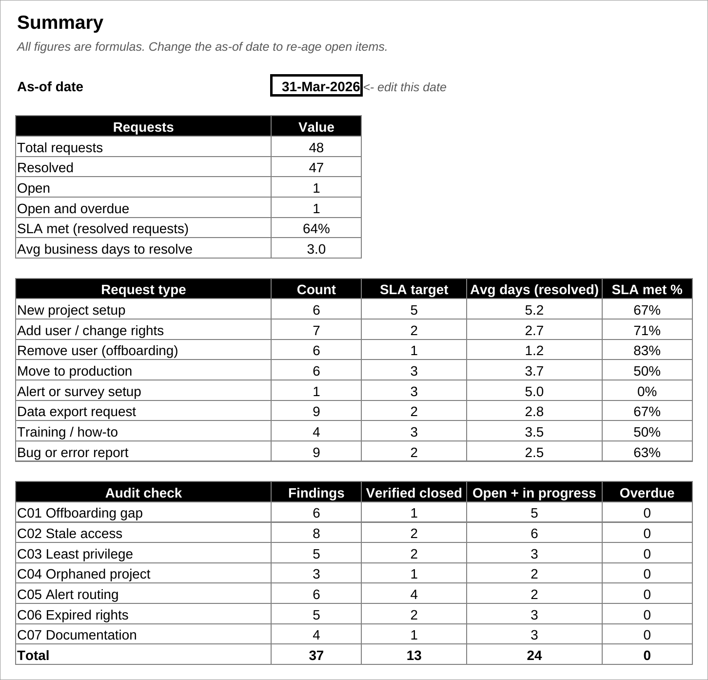

# REDCap Governance Audit & Request Tracker

SQL access-audit checks, a request tracker with service-level targets, and a corrective-action log for a REDCap research data platform, rebuilt from my work supporting REDCap administration in a public-health division.

> **All data is synthetic.** The organization, staff, projects, and alerts are invented. No agency data, names, or screenshots of real systems appear in this repo.

## Preview

The Summary tab of the workbook: request volume and SLA performance by type, plus audit findings by check. Every figure is a formula.



**[View every tab as a PDF](workbook/REDCap_Request_Tracker_and_Access_Audit.pdf)** (opens in the browser) · [Download the Excel file](workbook/REDCap_Request_Tracker_and_Access_Audit.xlsx) to see the formulas

## The problem

REDCap holds sensitive public-health data, and access tends to drift over time. People leave but their accounts stay active. Rights granted "temporarily" never expire. Alerts keep emailing people who have moved on. Projects lose their owners. None of it is visible unless someone cross-checks the platform against the staff roster and the access rules.

In my role, I reviewed REDCap project records, user access, alerts, documentation, and offboarding practices. I built Excel cross-reference trackers from REDCap exports and the MySQL data behind them to organize corrective actions and follow-up. This repo rebuilds that work as runnable SQL checks with a tracker around them.

## What's here

| Path | What it is |
|---|---|
| [`sql/access_audit_checks.sql`](sql/access_audit_checks.sql) | Seven audit checks in portable SQL (MySQL 8 and SQLite 3) |
| [`sql/schema.sql`](sql/schema.sql) | Tables: staff roster, REDCap users, projects, user rights, alerts |
| [`workbook/REDCap_Request_Tracker_and_Access_Audit.xlsx`](workbook/REDCap_Request_Tracker_and_Access_Audit.xlsx) | Request tracker with SLA scoring, audit corrective-action log, and a formula-driven summary |
| [`workbook/REDCap_Request_Tracker_and_Access_Audit.pdf`](workbook/REDCap_Request_Tracker_and_Access_Audit.pdf) | Every tab as a PDF, viewable without Excel |
| [`docs/intake_to_resolution.md`](docs/intake_to_resolution.md) | Request workflow, intake rules, least-privilege role matrix, and offboarding steps |
| [`data/`](data/) | Synthetic CSVs, the SQLite database, the answer key, and the audit findings |
| [`scripts/`](scripts/) | Data generator, check runner, and workbook builder |

## The checks

| Check | Catches | Why it matters |
|---|---|---|
| C01 Offboarding gap | Separated staff whose account is still active | A former employee can still reach sensitive data |
| C02 Stale access | No login in 90+ days but still holding project rights | Unused access is risk with no benefit |
| C03 Least privilege | Full (identifiable) export on a Data Entry or Viewer role | Identifiable data exposed beyond the need |
| C04 Orphaned project | Production project owned by a suspended account | No one is accountable for the data or its approvals |
| C05 Alert routing | Active alert sending to a non-staff address | Case data emailed outside the team |
| C06 Expired rights | Rights past their expiration date still in place | "Temporary" access that became permanent |
| C07 Documentation | Production project with no documentation on file | The project can't be supported or audited |

## Results (synthetic data)

180 staff, 40 projects, 314 user-rights records, and 60 alerts, with 37 seeded defects. The checks flag all 37 and nothing else:

```
$ python3 scripts/run_checks.py
Total flagged: 37 | seeded: 37 | missed: 0 | false positives: 0
```

One result is worth calling out. The first run flagged two alerts I hadn't seeded. Both sent to project owners who had been offboarded, so one missed offboarding step (re-routing alerts) had produced a second finding. I added them to the answer key as follow-on defects and wrote the step into the offboarding procedure in [`docs/intake_to_resolution.md`](docs/intake_to_resolution.md).

## The workbook

- **Requests:** 48 requests over one quarter. Business days to resolve, SLA target (looked up by request type), SLA met, and overdue flags are all formulas.
- **SLA Targets:** one target per request type. Change a target and every request is re-scored.
- **Audit Findings:** one row per flagged record, each with a corrective action, owner, due date, and status. A finding closes only when the check re-runs clean.
- **Summary:** SLA performance overall and by request type, plus findings by check and status.

## Run it

```bash
python3 scripts/generate_data.py   # builds data/ and the SQLite database
python3 scripts/run_checks.py      # runs all checks and scores them against the answer key
python3 scripts/build_workbook.py  # rebuilds the Excel workbook from the findings
```

Python 3 standard library plus `openpyxl` (for the workbook only).

## Skills this demonstrates

| Skill | Where to see it |
|---|---|
| Data governance and access control | The seven checks and the role matrix |
| SQL (joins, anti-joins, aggregation, portable syntax) | `sql/access_audit_checks.sql` |
| Process design and SOPs | `docs/intake_to_resolution.md` |
| Service management (intake, SLAs, triage) | Requests and SLA Targets tabs |
| Corrective-action tracking | Audit Findings tab |
| Testing my own work | Answer key and `run_checks.py` |
| Excel (NETWORKDAYS, INDEX/MATCH, COUNTIFS, data validation) | Workbook |

## Related work

- [hcm-payroll-data-mapping](https://github.com/bpearso5/hcm-payroll-data-mapping): source-to-target mapping and SQL integrity checks for an HR-to-payroll integration
- [hcm-implementation-pmo-artifacts](https://github.com/bpearso5/hcm-implementation-pmo-artifacts): project charter and RAID log for an HCM implementation
- [capital-project-submission-qa](https://github.com/bpearso5/capital-project-submission-qa): submission QA and weekly executive reporting

## How this was built

The checks, workflow, and offboarding gaps come from my experience supporting REDCap administration. I used Claude (AI) to help generate the synthetic data and draft the scripts. I reviewed every check, ran them against the answer key, and can explain each query line by line.

## About me

Brystal Pearson, CAPM · [LinkedIn](https://www.linkedin.com/in/brystal-pearson-capm) · [GitHub](https://github.com/bpearso5)
