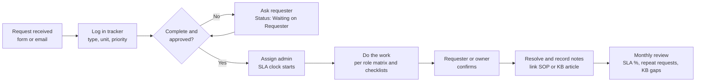

# REDCap Request Workflow: Intake to Resolution

How a request moves from "someone needs something" to "done and documented." Synthetic process for a fictional public-health REDCap team.

## Intake rules

| Request type | Required before work starts | SLA (business days) |
|---|---|---|
| New project setup | Data dictionary draft, project owner named, purpose | 5 |
| Add user / change rights | Project owner approval, role from the role matrix | 2 |
| Remove user (offboarding) | HR separation notice or supervisor request | 1 |
| Move to production | Pre-production checklist, owner sign-off | 3 |
| Alert or survey setup | Recipient list from active staff, test plan | 3 |
| Data export request | Owner approval; identifiable data needs written justification | 2 |
| Training / how-to | None | 3 |
| Bug or error report | Project ID and steps to reproduce | 2 |

## Role matrix (least privilege)

| Role | Data export | Design | User rights admin |
|---|---|---|---|
| Owner | Full | Yes | Yes |
| Analyst | Full or De-identified | No | No |
| Data Entry | None | No | No |
| Viewer | De-identified | No | No |

Anything outside the matrix needs written owner approval and an expiration date. Check C03 flags violations, and check C06 flags rights that have passed their expiration date.

## Offboarding (the step most often missed)

1. HR separation notice arrives. Log a "Remove user" request at High priority.
2. Suspend the REDCap account the same business day.
3. Remove the user's rights on every project.
4. **Re-route any alerts that send to the user's email.** This is the step that gets skipped: in the sample data, two alerts still went to project owners who had already been offboarded (check C05).
5. If the user owned a project, assign a new owner with supervisor approval before the next data cycle (check C04).
6. Resolve the request with a note listing the projects and alerts that were changed.

## Monthly governance review

- Re-run `sql/access_audit_checks.sql` and log every finding in the Audit Findings tab.
- Close a finding only after the check comes back clean for that record.
- Review SLA performance by request type, and turn repeat how-to questions into knowledge-base articles.
